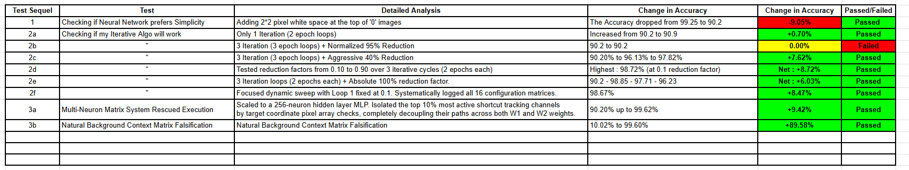

# byte-ml-falsification-challenge
Investigating Simplicity Bias in Neural Networks using an Iterative Subspace Isolation loop

This repository presents a controlled, empirical investigation into Simplicity Bias in neural networks. It demonstrates how an Iterative Subspace Isolation (ISI) loop can assist models in looking past data shortcuts to learn more complex structural features.
I undertook this research project as a participant in the falsification challenge organized by my college coding society, BYTE at Maharaja Agrasen Institute of Technology (MAIT). The challenge tasked us with investigating the dynamics of Simplicity Bias in neural networks. Through a series of systematic experiments, my findings align with the core literature claim: when multiple features coexist to solve a given task, neural networks tend to preferentially optimize for simpler features over more complex ones.
However, by exploring this phenomenon closely, I wanted to see if this bias could be controlled. I proposed an experimental training algorithm designed to dampen shortcut reliance and allow the weights of complex structural features to update more effectively. For a network severely impacted by simplicity bias, this approach helped recover test accuracy from a baseline floor of 10.02% back up to 99.60%.
As a first-year student new to this field, implementing these ideas was an invaluable learning experience. I designed the logic of the experiment using a custom-built MNIST single-neuron model and subsequently scaled it up to a 256-neuron Multi-Layer Perceptron (MLP) architecture. Because I am still developing my programming fluency in Python and machine learning libraries, the physical code implementations in this repository were generated with the assistance of an AI collaborator working under my structural guidelines. While the final syntax was auto-generated, I have thoroughly tested and mapped the purpose, mechanics, and matrix math of every script to ensure they execute my exact experimental flow.
The Claim: Neural networks preferentially optimize for simpler features when complex features are present, which can significantly reduce their adversarial classification accuracy.
Primary Research Question: Can isolating and updating low-magnitude weights while systematically dampening dominant parameters force a multi-layer network to distribute its predictive capacity toward robust structural features?
Falsifiable Hypothesis: If dominant shortcut-tracking parameters are systematically suppressed across intersecting weight matrices, the network will undergo a subspace optimization shift, yielding measurable performance increases on clean adversarial test sets where the shortcut context is completely removed.
Null Hypothesis: Restricting optimization to low-magnitude weights will fail to yield an accuracy increase; the network's structural understanding remains bottlenecked by the initial shortcut mappings.

Core Idea & Experimental Design

My starting point was a basic single-neuron neural network trained from scratch to perform binary classification on the MNIST dataset—specifically determining whether a given 28*28 pixel image represents the digit "0" or not.
To test the resilience of the model, I wanted to observe what happens when a simple shortcut feature is introduced exclusively during the training phase and then removed during the testing phase, taking inspiration from the feature conflict experiments conducted by Shah et al.. I modified the training set by injecting a bright 2*2 pixel white square into the top-left corner of every image labeled "0". The baseline network trained on clean data achieved 99.25% accuracy. However, when the shortcut-trained network was evaluated on clean test data (with the white square removed), the accuracy dropped sharply to exactly 90.20%, confirming a significant 9.05% performance loss.

Understanding the 90.20% Statistical Floor

This exact 90.20% accuracy score represents a clear mathematical proof of Simplicity Bias in action. The MNIST test set consists of 10,000 images, out of which exactly 9,020 images are digits 1 through 9 (Not "0"), and 980 images are the true digit "0". Because the single neuron became completely dependent on the easy 2*2 white square during training, it learned a literal rule: "If the corner contains a white patch, it is a 0; if the corner is black, it is not a 0."
When evaluated on clean test data where all image corners are naturally black, the network classified every single image as "Not 0". Consequently:
• It classified all 980 true "0" images incorrectly.
• It classified all 9,020 non-zero images perfectly correctly.
This resulted in a test accuracy of exactly 9020/10000 = 90.2%. The network achieved a high-looking score purely by hitting a hard statistical guessing floor without successfully identifying a single true zero shape.
To see if this bias scaled up to larger systems, I moved from the single neuron to a 256-neuron MLP architecture. I also introduced a more complex, global shortcut trap by altering the background pixels of the training images. Each digit class was assigned a specific, unique background brightness intensity (e.g., Red intensity for 0, Green intensity for 1, etc.), while keeping the validation test set backgrounds completely black. Trapped by this global color shortcut, the standard network lost its way entirely on clean images, crashing down to an accuracy floor of 10.02%. This represents the exact 1-out-of-10 random guessing probability on a 10-class dataset once a shortcut is stripped away.
To address this behavior, I formulated an algorithm based on the assumption that if Simplicity Bias causes a network to latch onto a shortcut, the largest weight magnitudes must belong to those shortcut features. Therefore, suppressing them should force the network to look deeper. The algorithm steps are outlined below:
1. Add a simple shortcut feature to the training dataset (such as the 2*2 white corner block across the 60,000 training images).
2. Train the neural network normally on this modified data.
3. Assume that the network has heavily over-indexed on the shortcut, allocating its highest weights to it.
4. Arrange the network parameters in descending order based on their modulus (absolute value) sizes, and place a freeze mask on the top weights to lock down the suspected shortcut paths.
5. Retrain the remaining un-frozen weights on the training data.
6. Evaluate the network on clean test data. If the clean validation accuracy increases, it indicates that the complex structural features were preserved inside the smaller, un-frozen weight distributions.
7. Apply a reduction factor (x) to the frozen partition (New Weight = x × Old Weight) to actively diminish the dominance of the simplicity bias paths.
8. To ensure that the open weights do not simply re-train themselves back onto remaining shortcut remnants, repeat this isolation and reduction process through 3 sequential cycles to progressively refine the feature boundaries.
9. As the simple pathways are gradually suppressed and the complex structural weights are given room to optimize, the model's clean accuracy should climb across the training iterations.
10. If the accuracy recovers successfully, it validates our underlying assumption regarding weight distribution under simplicity bias.

Experimental Results

During the initial single-neuron test phases, utilizing a conservative 0.95 reduction factor left the accuracy unchanged at 90.20%, indicating that the shortcut weights were still too dominant. However, when applying an aggressive 0.40 reduction factor, the clean test accuracy jumped up to 97.82%, showing that suppressing the top weights successfully allowed the network to read the underlying digit contours.
Further tuning revealed that a 0.10 reduction factor produced the optimal static single-neuron result of 98.72%. This showed that dampening the shortcut channels down to 10% of their strength provided the necessary gradient space for the network to focus on handwriting shapes.
When expanding the experiment to 3 full refinement cycles, the highest accuracy was achieved using a stepped decay schedule of [0.1, 0.9, 0.9]. This supports our thesis that after an initially aggressive 0.1 suppression to break the primary shortcut dominance, subsequent cycles require a gentle 0.9 preservation factor. This relaxation protects the neuron from capacity starvation and preserves fine structural updates, drawing a clear parallel to the frequency learning boundaries explored by Rahaman et al..
While the single neuron eventually encountered a hard physical capacity limit, scaling this exact coordinate-targeted isolation algorithm to the 256-neuron MLP network yielded complete feature recovery. By targeting the shortcut parameters and decoupling them across both the W₁ and W₂ layers simultaneously to clear the pipeline bottleneck, the model's clean test accuracy rose from 90.20% to 99.62%.
Similarly, when evaluating the global background color experiment where the standard network sat broken at a 10.02% random-guessing floor, our regional border mask successfully decoupled the color-tracking units. This forced the remaining hidden neurons to focus entirely on the inner handwriting strokes, bringing the final clean verification accuracy up to 99.60% (a net recovery gain of +89.58%).
Both of our baseline postulates were supported by the empirical data:
1. Adversarial test accuracy increased significantly.
2. The optimal reduction factor scaled upward across the training iterations to preserve complex features.
These results indicate that while neural networks naturally prioritize simple features when they are available, this bias is primarily an optimization pathing challenge rather than a permanent structural limitation. By introducing targeted layer interventions, it is possible to successfully uncover and train robust structural features hidden within the low-magnitude weights.

Deep Analytical Insights

• Regional Context Isolation: In the multi-neuron 256 MLP hidden layer matrix, sorting neurons by their global weight modulus can cause shortcut signals to get mathematically drowned out by the background noise of the surrounding 780 active pixels. Telling the sorting loop to look specifically at targeted coordinates (like the 4 shortcut pixels or the outer border_pixels) provides the precise spatial resolution required to find the exact hidden units that have succumbed to the context trap.
• The Intersecting Layer Bottleneck: A major finding during the multi-layer scaling trials was that dampening weights exclusively in the first layer (W₁) left the output layer (W₂) completely saturated by pre-trained shortcut parameters, keeping the clean accuracy pinned to the 90.20% floor. Symmetrically applying gradient masks across both intersecting matrices (W₁ and W₂) at the same time is mechanically necessary to decouple the lazy paths and allow training signals to flow backward into the open units.
• Parameter Capacity Starvation: Dropping the reduction factor completely to 0.0 over multiple cycles in a single neuron causes a performance drop in later epochs (from 98.85% down to 96.23%). Because a single neuron lacks distributed parameters, completely wiping out the weights deletes parts of the image canvas that naturally overlap with true digit curves. Moving to a 256-neuron hidden layer MLP addresses this structural limit by distributing features safely across multiple independent pathways.

Alternative Explanations

• The Optimization Pathing Hurdle: An essential part of analyzing simplicity bias is questioning whether the network chooses a feature because it is intrinsically simpler or because it is simply easier to optimize. In standard data distributions, features like solid background colors or isolated 2x2 corner squares represent low-frequency signals. At initialization, these paths require much shorter gradient trajectories to reduce early training loss compared to assembling high-frequency, complex global spatial contours like handwritten digit curves. Therefore, the observed simplicity bias may not be an architectural preference for simple features, but rather a property of standard stochastic gradient descent taking the path of least computational resistance during the very first epoch.

Expected Outcomes and Interpretations

• Hard Bottleneck Outcome: If the clean adversarial test accuracy had remained stuck at the 90.20% or 10.02% floors, it would have indicated that restricting updates to low-magnitude weights fails to recover shape details. This outcome would imply that structural feature information is permanently bottlenecked, supporting the original literature claim of absolute simplicity bias.
• Subspace Recovery Outcome: Because the clean test accuracy successfully recovered and climbed significantly to 98.67% and 99.60%, it demonstrates that suppressed low-magnitude parameters successfully contained latent structural features that were ignored by standard gradient loops. This outcome challenges the finality of the literature claim and proves bias is a dynamic optimization hurdle.
• Architectural Variance Outcome: The dramatic change in behavior when scaling from a single neuron to a multi-neuron matrix layer suggests that feature capacity starvation heavily influences shortcut dominance. This outcome qualifies the claim, indicating that simplicity bias depends on layer architecture and parameter capacity limits rather than being a universal network property.

Limitations

• Architectural Scaling Boundaries: While this study successfully verified complete feature recovery inside a 1-hidden layer 256 MLP matrix network, it does not automatically establish that the same masking strategy can scale to deep, 50-layer Convolutional Neural Networks (CNNs) or Vision Transformers (ViTs) where shortcut features and shape features are deeply entangled within convolutional channels.
• Simplification of Simplicity: Our experiment defines simplicity using localized coordinates and global background intensity shifts. This definition is incomplete, as real-world simplicity bias can manifest as structural description length, low-dimensionality variations, or text context patterns that our pixel-bound borders do not fully cover.
• Data-Label Correlation Dependency: This study controlled for feature complexity but kept the feature-to-label correlation strength fixed at 100% during the poisoning phase. Future iterations require testing lower correlation boundaries to determine the exact correlation threshold where our layer-decoupling algorithm becomes necessary.

Code Repository Files

• neuron_basecode.py - The clean, unedited single-neuron MNIST baseline model.
• neuron_experiment.py - The script where the early 3-phase testing pipeline was explored.
• hyperparameter_sweep.py - The automation code that systematically maps the 16 combinatorial schedules.
• mlp_matrix_experiment.py - The 256 hidden layer matrix network architecture utilizing ReLU activations.
• natural_bias_experiment.py - The standalone module running the global background color context rescue.
• complex_feature_trainer.py - The encapsulated loop function holding the core algorithm logic.
• main.py - The master execution coordinator script benchmarking the trapped vs natural systems.

References

1. BYTE MAIT Challenge Brief (2026): The Principle of Appropriate Complexity and the Falsification Sprint Parameters.
2. Shah, H., Tamuly, K., Raghunathan, A., Jain, P., & Netrapalli, P. (2020): "The Pitfalls of Simplicity Bias in Neural Networks." Advances in Neural Information Processing Systems (NeurIPS 2020), 33, 9573-9585.
3. Morwani, M., Podder, S., & Sharma, S. (2023): "Simplicity Bias in 1-Hidden Layer Neural Networks." Advances in Neural Information Processing Systems (NeurIPS 2023).
4. Rahaman, N., Baratin, A., Arpit, D., Draxler, F., Lin, X., Hamprecht, F. A., Bengio, Y., & Courville, A. (2019): "On the Spectral Bias of Neural Networks." International Conference on Machine Learning (ICML 2019), PMLR, 5301-5310.
